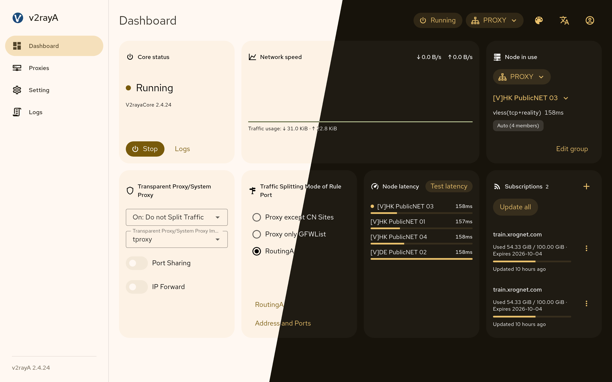
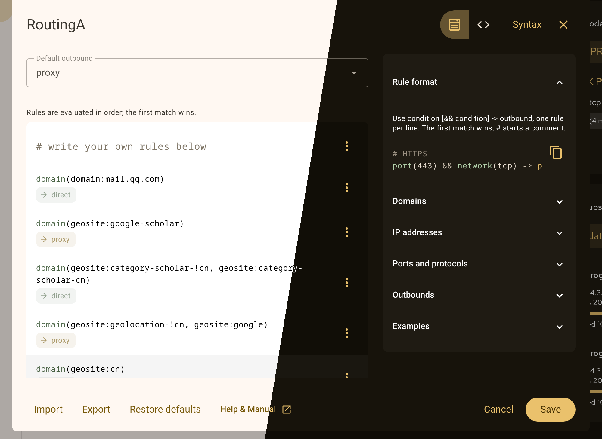

<div align="center">


# v2rayA

**A web client for its own Xray-based core, with transparent proxy on Linux, Windows and macOS.**

English · [简体中文](README_zh.md) · [Русский](README_ru.md)

[Requirements](#requirements) • [Install](#install) • [First run](#first-run) • [Transparent proxy](#transparent-proxy) • [Data and upgrades](#data-and-upgrades) • [Support](#support) • [About this fork](#about-this-fork)

</div>

v2rayA runs as a service and is used from a browser, on the machine itself or on a router or NAS. It imports subscriptions and share links for VMess, VLESS, Shadowsocks, Trojan, Hysteria2, TUIC, [Juicity](https://github.com/juicity), AnyTLS, WireGuard, SOCKS5 and HTTP(S), groups nodes and selects the member with the lowest measured latency or a pinned one, and splits traffic with rules written in RoutingA. ShadowsocksR is not supported.

> **This is a fork of [v2rayA](https://github.com/v2rayA/v2rayA).** It keeps the upstream name, layout and licence, and carries changes of its own — see [About this fork](#about-this-fork). Releases and the winget and scoop packages are published from [AnotherNot/v2rayA](https://github.com/AnotherNot/v2rayA); the APT and DNF repositories, AUR, Gentoo, brew, snap and OpenWrt still serve the upstream original.

## Requirements

| Component | Requirement |
| --- | --- |
| Core | `v2raya_core` of the **same version** as `v2raya`, next to it or in `PATH`. The packages and installers below ship both; a hand-installed pair must match. |
| Rule data | `geoip.dat` and `geosite.dat` in `/usr/share/v2raya` or `/usr/local/share/v2raya`. The packages ship them; a hand install downloads them from GitHub on the first start and exits if that fails. |
| Linux transparent proxy | root; `iptables` or `nftables` for `redirect` and `tproxy`; `/dev/net/tun` and `ip` from iproute2 for `tun` |
| Windows | Windows 10 build 14393 or later; administrator for `tun`; started without elevation it runs in lite mode and can still set the current user's system proxy |
| macOS | root for `tun`; started as a user it runs in lite mode with the system proxy instead |
| Browser | a current Chrome, Edge, Firefox or Safari |

## Install

The packages below install `v2raya` and `v2raya_core` together with a service definition. Enable the service with the command shown for the platform. The APT and DNF repositories, AUR, Gentoo, brew, snap and OpenWrt carry the upstream original rather than this fork; the channels below that name this repository carry the fork.

<details>
<summary><strong>Debian, Ubuntu and other APT distributions</strong></summary>

The packages come from the [Dae Universe repository](https://github.com/daeuniverse/repo-for-linux).

```sh
sudo apt update
sudo apt install curl
```

APT 3.0 or later:

```sh
sudo curl -fsSL -o /etc/apt/sources.list.d/daeuniverse.sources https://daeuniverse.pages.dev/daeuniverse.sources
```

APT older than 3.0:

```sh
sudo curl -fsSL -o /etc/apt/sources.list.d/daeuniverse.list https://daeuniverse.pages.dev/daeuniverse.list
```

Then the key and the package:

```sh
sudo curl -fsSL -o /usr/share/keyrings/daeuniverse-archive-goose.gpg https://daeuniverse.pages.dev/daeuniverse-archive-goose.gpg
sudo apt update
sudo apt install v2raya
sudo systemctl enable --now v2raya
```

Change the unit with `sudo systemctl edit --full v2raya.service`; an edit of the installed file is overwritten by the next upgrade.

A release also carries `installer_debian_x64_<version>.deb` (or `arm64`) for a machine where the repository is not an option:

```sh
sudo dpkg -i installer_debian_x64_<version>.deb
```

</details>

<details>
<summary><strong>Fedora, RHEL, openSUSE and other RPM distributions</strong></summary>

Fedora, RHEL and derivatives:

```sh
sudo curl -fsSL -o /etc/yum.repos.d/daeuniverse.repo https://daeuniverse.pages.dev/daeuniverse.repo
sudo dnf install v2raya
```

openSUSE:

```sh
sudo curl -fsSL -o /etc/zypp/repos.d/daeuniverse.repo https://daeuniverse.pages.dev/daeuniverse.repo
sudo zypper install v2raya
```

Then:

```sh
sudo systemctl enable --now v2raya
```

A release also carries `installer_redhat_x64_<version>.rpm` (or `arm64`):

```sh
sudo rpm -i installer_redhat_x64_<version>.rpm
sudo systemctl enable --now v2raya
```

</details>

<details>
<summary><strong>Arch Linux</strong></summary>

`v2raya` builds from source, `v2raya-bin` uses the release binaries; both are in the AUR. The release page also carries `installer_archlinux_<arch>_<version>.pkg.tar.zst` for `pacman -U`.

```sh
paru -S v2raya-bin
sudo systemctl enable --now v2raya
```

</details>

<details>
<summary><strong>Gentoo, Alpine and other OpenRC systems</strong></summary>

On Gentoo, install from the [gentoo-zh](https://github.com/gentoo-zh/overlay) overlay, then enable the service:

```sh
sudo emerge net-proxy/v2rayA
sudo rc-update add v2raya default
sudo rc-service v2raya start
```

On Alpine, take `installer_alpine_x64_${VERSION}.apk` (or `arm64`) from the [releases](https://github.com/AnotherNot/v2rayA/releases). The archive carries the OpenRC script and `/etc/conf.d/v2raya`; it is not signed with a key in Alpine's trust store, hence `--allow-untrusted`:

```sh
sudo apk add --allow-untrusted ./installer_alpine_x64_${VERSION}.apk
sudo rc-update add v2raya default
sudo rc-service v2raya start
```

Elsewhere, download `v2raya_linux_x64_${VERSION}.tar.gz` (or `arm64`) and the OpenRC files from [`install/universal/`](install/universal/). Run this from a checkout of the repository, with `VERSION` set to the release number without the leading `v`; the example is for x64:

```sh
mkdir -p /tmp/v2raya
tar -xzf "v2raya_linux_x64_${VERSION}.tar.gz" -C /tmp/v2raya
sudo install -m755 /tmp/v2raya/v2raya /usr/bin/v2raya
sudo install -m755 /tmp/v2raya/v2raya_core /usr/bin/v2raya_core
sudo install -m755 install/universal/v2raya.initd /etc/init.d/v2raya
sudo install -m644 install/universal/v2raya.confd /etc/conf.d/v2raya
sudo rc-update add v2raya default
sudo rc-service v2raya start
```

</details>

<details>
<summary><strong>Docker</strong></summary>

The fork publishes an image on GitHub Container Registry for `linux/amd64` and `linux/arm64`. `latest` is moved by every release that is not a pre-release; a release also carries its version as a tag (`2.5.14` and `v2.5.14`). No login is needed:

```sh
docker run -d --restart=always --network=host \
  --cap-drop ALL --cap-add NET_ADMIN --cap-add NET_RAW \
  --device /dev/net/tun --security-opt no-new-privileges \
  --name v2raya \
  -e V2RAYA_LOG_FILE=/tmp/v2raya.log \
  -v /lib/modules:/lib/modules:ro \
  -v /etc/resolv.conf:/etc/resolv.conf \
  -v /etc/v2raya:/etc/v2raya \
  ghcr.io/anothernot/v2raya:latest
```

This example is for a Linux host and gives the container the host network and only the two capabilities and the TUN device the transparent proxy needs; `--privileged` is not required. Add `--read-only --tmpfs /tmp --tmpfs /run -e V2RAYA_V2RAY_ASSETSDIR=/etc/v2raya` when the root filesystem should stay immutable; the geo databases are downloaded into the data volume on the first start. To build the image from source instead, which needs only Docker:

```sh
docker build -f install/docker/Dockerfile -t v2raya-local .
docker run -d --restart=always --network=host \
  --cap-drop ALL --cap-add NET_ADMIN --cap-add NET_RAW \
  --device /dev/net/tun --security-opt no-new-privileges \
  --name v2raya \
  -e V2RAYA_LOG_FILE=/tmp/v2raya.log \
  -v /lib/modules:/lib/modules:ro \
  -v /etc/resolv.conf:/etc/resolv.conf \
  -v /etc/v2raya:/etc/v2raya \
  v2raya-local
```

With bridge networking instead, publish port 2017 and the inbound ports you use, turn on port sharing in the settings, and set a port-sharing username and password; without both, the inbounds stay on the container's loopback and the published ports refuse connections. Transparent proxy is not available in that setup.

[`install/docker/docker-compose.yaml`](install/docker/docker-compose.yaml) carries both layouts as Compose profiles, with the first-run and port-sharing notes:

```sh
docker compose -f install/docker/docker-compose.yaml --profile transparent up -d  # host network
docker compose -f install/docker/docker-compose.yaml --profile socks up -d        # bridge, published SOCKS5
```

</details>

<details>
<summary><strong>Windows</strong></summary>

`installer_windows_inno_x64_<version>.exe` (or `arm64`) from the [releases](https://github.com/AnotherNot/v2rayA/releases) installs both binaries and registers a service. The same release also carries `v2raya_windows_x64_<version>.zip` (or `arm64`) for a machine without the installer. The installer is behind `winget install --id AnotherNot.v2rayA` and the fork's scoop bucket (`scoop bucket add v2raya https://github.com/AnotherNot/scoop-v2raya && scoop install v2raya`).

</details>

<details>
<summary><strong>macOS</strong></summary>

The [tap](https://github.com/v2rayA/homebrew-v2raya) installs both binaries. Started as root the service has the `tun` transparent proxy; started as you it runs in lite mode with the system proxy:

```sh
brew tap v2raya/v2raya
brew install v2raya/v2raya/v2raya
sudo brew services start v2raya   # root: tun
brew services start v2raya        # you: system proxy
```

A service started with `sudo` is stopped with `sudo brew services stop v2raya`, and Homebrew warns that the upgrade or uninstall of a root-started formula needs `sudo rm` of the paths it names.

</details>

<details>
<summary><strong>OpenWrt</strong></summary>

The [v2raya-openwrt](https://github.com/v2rayA/v2raya-openwrt) feed and the official packages feed currently package 2.2.7.x with a separate `xray-core`, not the release described here. Until they are updated, install the `arm64` or `x64` release binaries by hand, as in the next section, with the init script of your choice.

</details>

<details>
<summary><strong>Other Linux, without a package</strong></summary>

Download `v2raya_linux_x64_<version>.tar.gz` (or `arm64`) and the `SHA256SUMS` published with the [release](https://github.com/AnotherNot/v2rayA/releases), verify the archive, unpack it and install both binaries into `/usr/bin`:

```sh
grep " v2raya_linux_x64_${VERSION}.tar.gz\$" SHA256SUMS | sha256sum -c -
tar -xzf "v2raya_linux_x64_${VERSION}.tar.gz"
sudo install -m755 v2raya v2raya_core /usr/bin/
```

With systemd:

```sh
sudo install -m644 install/universal/v2raya.service /etc/systemd/system/v2raya.service
sudo systemctl daemon-reload
sudo systemctl enable --now v2raya
```

With OpenRC, use the files from the section above. There is also a [snap](https://snapcraft.io/v2raya) maintained separately.

</details>

## First run

The service listens on `127.0.0.1:2017` by default; to reach it from another machine, pass `--address 0.0.0.0:2017` and restrict who can connect with a firewall or a TLS reverse proxy. The first account registered becomes the administrator; the registration form asks for the one-time setup token printed on first start (it is also written to `setup-token` in the configuration directory) and the token is removed once the account exists. Restrict access before registering on a shared network.

Open the interface and create the administrator. The tutorial then walks through importing a subscription or a share link, adding the nodes to a group and choosing the routing rules; start the core with Start on the dashboard or the status button at the top of the page.

Once the core runs, point an application at SOCKS5 with rules `127.0.0.1:20170` (the only inbound on by default; the rest are under Settings → Address and Ports), or turn on transparent proxy on the dashboard and pick a mode from the table below. A group with several connected members uses the one with the lowest measured latency, or spreads connections when its type is Random; pinning a member routes the group through it alone. Subscriptions update from the subscriptions page or on the interval set in the settings.

The day-to-day operation — nodes, groups, modes, DNS, logs, backups — is
covered step by step in [docs/user-guide.md](docs/user-guide.md) (in Russian:
[docs/user-guide-ru.md](docs/user-guide-ru.md)).



## Transparent proxy

| Platform | Modes |
| --- | --- |
| Linux | `redirect`, `tproxy`, `tun`; with `--lite`, the system proxy on GNOME and KDE |
| macOS | `tun`; with `--lite`, the system proxy |
| Windows | `tun`, system proxy |

The system proxy modes set the desktop's proxy settings and cover applications that honour them. The other modes intercept traffic.

With `tun`, the core opens a TUN device and assigns its address; with automatic routing on (the default), v2rayA installs the routes and the DNS setting, otherwise your own script does. The core's own connections, the direct outbound and the DNS module's upstream queries never enter the TUN (by socket mark on Linux, by binding to the physical interface on Windows and macOS). Plain DNS on port 53 that reaches the TUN is answered by the core's DNS module; encrypted DNS is not intercepted. v2rayA and the core are always excluded, and other processes can be excluded by executable name in the settings. More specific connected and static routes bypass the TUN.

Known limitation: on Windows and macOS an application that queries a LAN resolver directly still bypasses the TUN. The system resolver is covered: Windows points it at the TUN gateway, macOS at the core's listener on `127.0.0.1`, which needs port 53 free.

## Routing rules



RoutingA has a list mode with a form per rule and a text mode with line numbers, colouring and per-line checks. The syntax reference sits beside the editor. Import or export rules as a text file.

## Data and upgrades

The SQLite database `v2raya.db` and the generated core config live in the configuration directory: `/etc/v2raya` on Linux and macOS, `%ProgramData%\SYSTEM\v2rayA` for the Windows service, the user's config directory with `--lite`, or the path given by `--config`. Logs go to `/var/log/v2raya/v2raya.log` under the systemd and OpenRC units, or to `--log-file` / `V2RAYA_LOG_FILE`. Network requests are made for subscription updates, rule-data downloads, latency probes, DNS, a release check against GitHub at start and weekly, and an NTP query (`pool.ntp.org`) when a VMess node fails, to tell a wrong clock from a bad node.

Stop the service and back up the configuration directory before upgrading. Upgrading from a release before 2.4 migrates the BoltDB database on the first start; the old file is kept as `bolt.db.bak` (`bolt.db.bak.1` and up when that name is taken), and accounts have to be registered again. Upgrade `v2raya` and `v2raya_core` together: the dashboard shows the core version, and a mismatch is reported in a banner.

## Support

Ask questions in the [discussions](https://github.com/AnotherNot/v2rayA/discussions) and report bugs in the [issues](https://github.com/AnotherNot/v2rayA/issues).

Do not use this project for anything illegal.

## About this fork

This is a maintained fork of [v2rayA](https://github.com/v2rayA/v2rayA), which is where a defect in the original belongs rather than here. The credits for the project itself are below.

Every change in this fork was written by coding agents. The person behind it decided what to add, what to remove and what the result should look like, tested each change against a running installation, and answered for it. The working rules those changes were held to are in [AGENTS.md](AGENTS.md). A change is not finished until it has been observed working.

The changes themselves: the routing modes are named for what they do rather than for one region, and the stored values behind them were migrated to match; the default DNS resolver is region-neutral; the updater for blocklist rule sets is generalised from the single set it used to be tied to; the rule presets that ship with the project were checked against real nodes; groups gained a random balancing type; a single SOCKS5 inbound with rules is the one enabled by default; a measured node speed is kept rather than recomputed on every page; the project builds in containers with one command; and the fork publishes its own releases, winget package and scoop bucket.

None of that was invented where an existing shape would do. [docs/README.md](docs/README.md#what-the-code-stands-on) lists what the code stands on in full; in short, the share-link dialect and the rule-index format come from [v2rayN](https://github.com/2dust/v2rayN), the routing model and the balancer tags from [Xray-core](https://github.com/XTLS/Xray-core) — which `v2raya_core` itself forks — the DNS wire handling from [miekg/dns](https://github.com/miekg/dns), the published Russian rule sets from [runetfreedom](https://github.com/runetfreedom/russia-v2ray-rules-dat), the geo files from [v2fly/domain-list-community](https://github.com/v2fly/domain-list-community) and [v2fly/geoip](https://github.com/v2fly/geoip), and the rule syntax from [RoutingA](https://github.com/v2rayA/RoutingA).

Where a line, a structure or a mechanism here repeats a third-party solution, that solution and its licence belong to its author, and this repository claims no credit for it. What this fork adds is the set of changes described above and the work of keeping them building and tested.

## Credits

Founded by [@mzz2017](https://github.com/mzz2017). The Material Design 3 interface, the in-core TUN and the 2.5 service rework are by [@Zakkaus](https://github.com/Zakkaus). The OpenRC files come from the [gentoo-zh community](https://gentoozh.org). Routing data from [v2fly/domain-list-community](https://github.com/v2fly/domain-list-community), [v2fly/geoip](https://github.com/v2fly/geoip) and, for the blocklist mode, [Loyalsoldier/v2ray-rules-dat](https://github.com/Loyalsoldier/v2ray-rules-dat); the transparent-proxy rules were learnt from [zfl9/ss-tproxy](https://github.com/zfl9/ss-tproxy) and [hq450/fancyss](https://github.com/hq450/fancyss).

## License

[AGPL-3.0-only](LICENSE). The core is a fork of [Xray-core](https://github.com/XTLS/Xray-core) (MPL-2.0).
