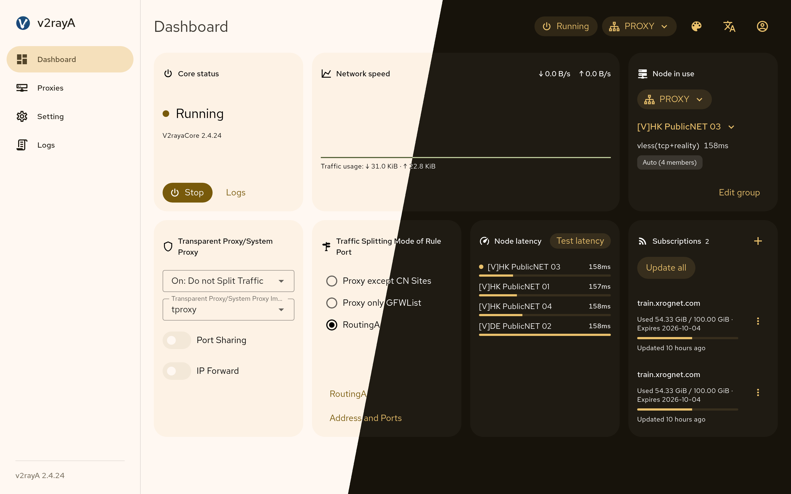
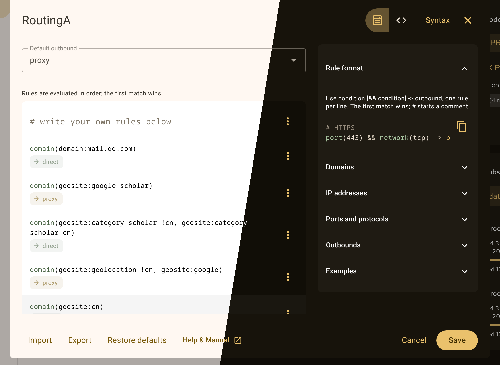

<div align="center">


# v2rayA

**Веб-клиент для собственного ядра на базе Xray с прозрачным прокси в Linux, Windows и macOS.**

[English](README.md) · [简体中文](README_zh.md) · Русский

[Требования](#требования) • [Установка](#установка) • [Первый запуск](#первый-запуск) • [Прозрачный прокси](#прозрачный-прокси) • [Данные и обновления](#данные-и-обновления) • [Поддержка](#поддержка) • [Об этом форке](#об-этом-форке)

</div>

v2rayA работает как служба и управляется из браузера — на самом компьютере, на маршрутизаторе или NAS. Он импортирует подписки и ссылки VMess, VLESS, Shadowsocks, Trojan, Hysteria2, TUIC, [Juicity](https://github.com/juicity), AnyTLS, WireGuard, SOCKS5 и HTTP(S), объединяет узлы в группы, выбирает узел с наименьшей измеренной задержкой или закреплённый узел и разделяет трафик по правилам RoutingA. ShadowsocksR не поддерживается.

> **Это форк [v2rayA](https://github.com/v2rayA/v2rayA).** Он сохраняет исходное название, устройство и лицензию и несёт собственные изменения — см. [Об этом форке](#об-этом-форке). Выпуски, пакеты winget и scoop публикуются из [AnotherNot/v2rayA](https://github.com/AnotherNot/v2rayA); репозитории APT и DNF, AUR, Gentoo, brew, snap и OpenWrt по-прежнему отдают upstream-оригинал.

## Требования

| Компонент | Требование |
| --- | --- |
| Ядро | `v2raya_core` **той же версии**, что и `v2raya`, рядом с ним или в `PATH`. Пакеты и установщики ниже ставят оба файла; при ручной установке версии должны совпадать |
| Данные правил | `geoip.dat` и `geosite.dat` в `/usr/share/v2raya` или `/usr/local/share/v2raya`. Пакеты содержат их; при ручной установке они скачиваются с GitHub при первом запуске, и при неудаче служба завершается |
| Прозрачный прокси в Linux | root; `iptables` или `nftables` для `redirect` и `tproxy`; `/dev/net/tun` и команда `ip` из iproute2 для `tun` |
| Windows | Windows 10 сборки 14393 или новее; права администратора для `tun`; запущенный без повышения прав, работает в режиме lite и всё же может настроить системный прокси текущего пользователя |
| macOS | root для `tun`; запущенный от пользователя, работает в режиме lite с системным прокси |
| Браузер | актуальный Chrome, Edge, Firefox или Safari |

## Установка

Пакеты ниже устанавливают `v2raya` и `v2raya_core` вместе с описанием службы. Включите службу командой, указанной для платформы. Репозитории APT и DNF, AUR, Gentoo, brew, snap и OpenWrt содержат upstream-оригинал, а не этот форк; каналы ниже, где назван этот репозиторий, содержат форк.

<details>
<summary><strong>Debian, Ubuntu и другие дистрибутивы с APT</strong></summary>

Пакеты берутся из [репозитория Dae Universe](https://github.com/daeuniverse/repo-for-linux).

```sh
sudo apt update
sudo apt install curl
```

APT 3.0 и новее:

```sh
sudo curl -fsSL -o /etc/apt/sources.list.d/daeuniverse.sources https://daeuniverse.pages.dev/daeuniverse.sources
```

APT версии ниже 3.0:

```sh
sudo curl -fsSL -o /etc/apt/sources.list.d/daeuniverse.list https://daeuniverse.pages.dev/daeuniverse.list
```

Затем ключ и пакет:

```sh
sudo curl -fsSL -o /usr/share/keyrings/daeuniverse-archive-goose.gpg https://daeuniverse.pages.dev/daeuniverse-archive-goose.gpg
sudo apt update
sudo apt install v2raya
sudo systemctl enable --now v2raya
```

Юнит меняйте через `sudo systemctl edit --full v2raya.service`: правку установленного файла перезапишет следующее обновление.

</details>

<details>
<summary><strong>Fedora, RHEL, openSUSE и другие дистрибутивы с RPM</strong></summary>

Fedora, RHEL и производные:

```sh
sudo curl -fsSL -o /etc/yum.repos.d/daeuniverse.repo https://daeuniverse.pages.dev/daeuniverse.repo
sudo dnf install v2raya
```

openSUSE:

```sh
sudo curl -fsSL -o /etc/zypp/repos.d/daeuniverse.repo https://daeuniverse.pages.dev/daeuniverse.repo
sudo zypper install v2raya
```

Затем:

```sh
sudo systemctl enable --now v2raya
```

</details>

<details>
<summary><strong>Arch Linux</strong></summary>

В AUR `v2raya` собирается из исходников, `v2raya-bin` использует готовые бинарные файлы. На странице выпусков есть и `installer_archlinux_<arch>_<version>.pkg.tar.zst` для `pacman -U`.

```sh
paru -S v2raya-bin
sudo systemctl enable --now v2raya
```

</details>

<details>
<summary><strong>Gentoo, Alpine и другие системы с OpenRC</strong></summary>

В Gentoo установите пакет из оверлея [gentoo-zh](https://github.com/gentoo-zh/overlay) и включите службу:

```sh
sudo emerge net-proxy/v2rayA
sudo rc-update add v2raya default
sudo rc-service v2raya start
```

В Alpine возьмите `installer_alpine_linux_x64_${VERSION}.apk` со [страницы выпусков](https://github.com/AnotherNot/v2rayA/releases), заменив часть имени с архитектурой на подходящую. В архиве лежат скрипт OpenRC и `/etc/conf.d/v2raya`; он не подписан ключом из доверенного хранилища Alpine, поэтому нужен `--allow-untrusted`:

```sh
sudo apk add --allow-untrusted ./installer_alpine_linux_x64_${VERSION}.apk
sudo rc-update add v2raya default
sudo rc-service v2raya start
```

В остальных системах скачайте оба бинарных файла для своей архитектуры со [страницы выпусков](https://github.com/AnotherNot/v2rayA/releases) и возьмите файлы OpenRC из [`install/universal/`](install/universal/). Команды выполняются из клона репозитория; `VERSION` — номер выпуска без ведущей `v`; пример для x64:

```sh
sudo install -m755 "v2raya_linux_x64_${VERSION}" /usr/bin/v2raya
sudo install -m755 "v2raya_core_linux_x64_${VERSION}" /usr/bin/v2raya_core
sudo install -m755 install/universal/v2raya.initd /etc/init.d/v2raya
sudo install -m644 install/universal/v2raya.confd /etc/conf.d/v2raya
sudo rc-update add v2raya default
sudo rc-service v2raya start
```

</details>

<details>
<summary><strong>Docker</strong></summary>

Форк публикует образ в registry для `linux/amd64` и `linux/arm64`. `latest` сдвигает каждый выпуск, не помеченный как предварительный; у выпуска есть и теги версии (`2.5.14` и `v2.5.14`). Вход не нужен:

```sh
docker run -d --restart=always --privileged --network=host --name v2raya \
  -e V2RAYA_LOG_FILE=/tmp/v2raya.log \
  -v /lib/modules:/lib/modules:ro \
  -v /etc/resolv.conf:/etc/resolv.conf \
  -v /etc/v2raya:/etc/v2raya \
  ghcr.io/anothernot/v2raya:latest
```

Пример для хоста Linux: контейнер получает сеть хоста и привилегии, без которых прозрачный прокси не работает. Чтобы собрать образ из исходников (нужен только Docker):

```sh
docker build -f install/docker/Dockerfile -t v2raya-local .
docker run -d --restart=always --privileged --network=host --name v2raya \
  -e V2RAYA_LOG_FILE=/tmp/v2raya.log \
  -v /lib/modules:/lib/modules:ro \
  -v /etc/resolv.conf:/etc/resolv.conf \
  -v /etc/v2raya:/etc/v2raya \
  v2raya-local
```

При сети bridge опубликуйте порт 2017 и используемые входящие порты и включите общий доступ к портам в настройках, иначе входящие подключения принимаются только на loopback контейнера. Прозрачный прокси в такой схеме недоступен.

</details>

<details>
<summary><strong>Windows</strong></summary>

`installer_windows_inno_x64_<version>.exe` (или `arm64`) со [страницы выпусков](https://github.com/AnotherNot/v2rayA/releases) устанавливает оба бинарных файла и регистрирует службу. Тот же установщик стоит за `winget install --id AnotherNot.v2rayA` и за scoop-бакетом форка (`scoop bucket add v2raya https://github.com/AnotherNot/scoop-v2raya && scoop install v2raya`)).

</details>

<details>
<summary><strong>macOS</strong></summary>

[Tap](https://github.com/v2rayA/homebrew-v2raya) устанавливает оба бинарных файла. Запущенная от root служба даёт прозрачный прокси `tun`; запущенная от вас — работает в режиме lite с системным прокси:

```sh
brew tap v2raya/v2raya
brew install v2raya/v2raya/v2raya
sudo brew services start v2raya   # root: tun
brew services start v2raya        # вы: системный прокси
```

Службу, запущенную через `sudo`, останавливают командой `sudo brew services stop v2raya`; Homebrew предупреждает, что обновление или удаление formula, запускавшейся от root, требует `sudo rm` перечисленных им путей.

</details>

<details>
<summary><strong>OpenWrt</strong></summary>

Репозиторий [v2raya-openwrt](https://github.com/v2rayA/v2raya-openwrt) и официальный репозиторий packages сейчас содержат 2.2.7.x с отдельным `xray-core`, а не описанный здесь выпуск. Пока они не обновлены, установите бинарные файлы выпуска для `mips32`, `mips32le`, `arm64` или `x64` вручную, как в следующем разделе, с собственным init-скриптом.

</details>

<details>
<summary><strong>Другой Linux, без пакета</strong></summary>

Скачайте `v2raya_linux_<arch>_<version>` и `v2raya_core_linux_<arch>_<version>` со [страницы выпусков](https://github.com/AnotherNot/v2rayA/releases) (`x86`, `x64`, `arm64`, `armv7`, `riscv64`, `loongarch64`, `mips32`, `mips32le`, `mips64`, `mips64le`), сверьте их с соседним `.sha256.txt` и установите оба в `/usr/bin`. Для systemd:

```sh
sudo install -m644 install/universal/v2raya.service /etc/systemd/system/v2raya.service
sudo systemctl daemon-reload
sudo systemctl enable --now v2raya
```

Для OpenRC используйте файлы из раздела выше. Есть и отдельно поддерживаемый [snap](https://snapcraft.io/v2raya).

</details>

## Первый запуск

Служба слушает `0.0.0.0:2017`, поэтому на маршрутизаторе или NAS интерфейс доступен по адресу `http://<адрес-устройства>:2017`. Первая зарегистрированная учётная запись становится администратором; форма регистрации запрашивает одноразовый токен установки, который печатается при первом запуске (он также записывается в файл `setup-token` в каталоге конфигурации) и удаляется после создания учётной записи. В общей сети сначала ограничьте доступ, либо для локального использования запустите службу с `--address 127.0.0.1:2017`.

Откройте интерфейс и создайте администратора. Затем мастер проведёт через импорт подписки или ссылки, добавление узлов в группу и выбор правил маршрутизации; ядро запускается кнопкой запуска на панели или кнопкой состояния вверху страницы.

Когда ядро работает, укажите приложению SOCKS5 с правилами `127.0.0.1:20170` (единственный включённый по умолчанию входящий порт; остальные — в разделе «Настройки → Адреса и порты») либо включите прозрачный прокси на панели и выберите режим из таблицы ниже. Группа с несколькими подключёнными узлами использует узел с наименьшей измеренной задержкой, а при типе Random распределяет соединения; после закрепления узла весь трафик группы направляется через него. Подписки обновляются со страницы подписок или с интервалом, заданным в настройках.

Повседневная работа — узлы, группы, режимы, DNS, журналы, резервные копии —
пошагово описана в [docs/user-guide-ru.md](docs/user-guide-ru.md) (на
английском: [docs/user-guide.md](docs/user-guide.md)).



## Прозрачный прокси

| Платформа | Режимы |
| --- | --- |
| Linux | `redirect`, `tproxy`, `tun`; с `--lite` — системный прокси в GNOME и KDE |
| macOS | `tun`; с `--lite` — системный прокси |
| Windows | `tun`, системный прокси |

Режимы системного прокси меняют настройки прокси рабочего стола и охватывают только приложения, которые их соблюдают. Остальные режимы перехватывают трафик.

В режиме `tun` ядро открывает устройство TUN и назначает ему адрес; при включённой автоматической маршрутизации (по умолчанию) маршруты и настройку DNS устанавливает v2rayA, иначе — ваш собственный скрипт. Собственные соединения ядра, прямой исходящий трафик и запросы DNS-модуля к вышестоящим серверам не попадают в TUN (в Linux — метки сокетов, в Windows и macOS — привязка к физическому интерфейсу). На незашифрованные DNS-запросы на порт 53, попавшие в TUN, отвечает DNS-модуль ядра; зашифрованный DNS не перехватывается. v2rayA и ядро исключаются всегда; другие процессы можно исключить в настройках по имени исполняемого файла. Более специфичные маршруты подключённых сетей и статические маршруты обходят TUN.

Известное ограничение: в Windows и macOS приложение, которое обращается напрямую к DNS-серверу в локальной сети, по-прежнему обходит TUN. Системный резолвер охвачен: Windows направляет его на шлюз TUN, macOS — на слушатель ядра на `127.0.0.1`, для которого порт 53 должен быть свободен.

## Правила маршрутизации



У RoutingA два режима: список с формой для каждого правила и текст с номерами строк, подсветкой и построчной проверкой. Справка по синтаксису находится рядом с редактором. Правила можно импортировать из файла и экспортировать в файл.

## Данные и обновления

База SQLite `v2raya.db` и сгенерированная конфигурация ядра лежат в каталоге конфигурации: `/etc/v2raya` в Linux и macOS, `%ProgramData%\SYSTEM\v2rayA` для службы Windows, каталог конфигурации пользователя при `--lite` или путь из `--config`. Журналы пишутся в `/var/log/v2raya/v2raya.log` юнитами systemd и OpenRC либо в `--log-file` / `V2RAYA_LOG_FILE`. Сетевые запросы выполняются для обновления подписок, загрузки данных правил, измерения задержки, DNS, проверки новой версии на GitHub при запуске и раз в неделю, а также запроса NTP (`pool.ntp.org`) при сбое узла VMess, чтобы отличить неверные часы от неисправного узла.

Перед обновлением остановите службу и сделайте резервную копию каталога конфигурации. При обновлении с версии ниже 2.4 база BoltDB переносится при первом запуске; старый файл сохраняется как `bolt.db.bak` (`bolt.db.bak.1` и далее, если это имя занято), учётные записи нужно зарегистрировать заново. Обновляйте `v2raya` и `v2raya_core` вместе: панель показывает версию ядра, а о несовпадении сообщает баннер.

## Поддержка

Задавайте вопросы в [Discussions](https://github.com/AnotherNot/v2rayA/discussions) и сообщайте об ошибках в [Issues](https://github.com/AnotherNot/v2rayA/issues).

Не используйте этот проект в противоправных целях.

## Об этом форке

Это поддерживаемый форк [v2rayA](https://github.com/v2rayA/v2rayA): дефект, найденный в оригинале, следует отправлять туда, а не сюда. Авторы самого проекта перечислены ниже.

Все изменения в этом форке написаны кодинг-агентами. Человек, который за ними стоит, решал, что добавить, что убрать и каким должен получиться результат, проверял каждое изменение на работающей установке и отвечал за него. Правила, по которым изменения проходили приёмку, изложены в [AGENTS.md](AGENTS.md). Изменение не считается законченным, пока его не увидели работающим.

Сами изменения: режимы маршрутизации названы по тому, что они делают, а не по одному региону, и хранимые за ними значения мигрированы под новые названия; DNS-резолвер по умолчанию не привязан к региону; обновитель наборов правил для режима blocklist обобщён с одного набора, к которому был привязан; поставляемые с проектом пресеты правил проверены на реальных узлах; группы получили случайный тип балансировки; по умолчанию включён единственный входящий порт SOCKS5 с правилами; измеренная скорость узла сохраняется, а не пересчитывается при каждом открытии страницы; проект собирается в контейнерах одной командой; форк публикует собственные выпуски, пакет winget и scoop-бакет.

Ничего из этого не изобреталось там, где уже есть готовая форма. [docs/README.md](docs/README.md#what-the-code-stands-on) перечисляет, на чём стоит код, полностью; коротко: диалект share-ссылок и форма индекса правил взяты из [v2rayN](https://github.com/2dust/v2rayN), модель маршрутизации и теги балансировщиков — из [Xray-core](https://github.com/XTLS/Xray-core), форком которого является сам `v2raya_core`, работа с DNS на уровне протокола — из [miekg/dns](https://github.com/miekg/dns), публикуемые российские наборы правил — из [runetfreedom](https://github.com/runetfreedom/russia-v2ray-rules-dat), geo-файлы — из [v2fly/domain-list-community](https://github.com/v2fly/domain-list-community) и [v2fly/geoip](https://github.com/v2fly/geoip), синтаксис правил — из [RoutingA](https://github.com/v2rayA/RoutingA).

Где строка, структура или механизм повторяет стороннее решение, такое решение и его лицензия принадлежат его автору, и этот репозиторий не претендует на него. Что добавляет форк — перечисленный набор изменений и работа по тому, чтобы всё собиралось и проходило проверки.

## Благодарности

Основан [@mzz2017](https://github.com/mzz2017). Интерфейс на Material Design 3, встроенный в ядро TUN и переработка службы в 2.5 — [@Zakkaus](https://github.com/Zakkaus). Файлы OpenRC предоставлены [сообществом gentoo-zh](https://gentoozh.org). Данные маршрутизации — [v2fly/domain-list-community](https://github.com/v2fly/domain-list-community) и [v2fly/geoip](https://github.com/v2fly/geoip), для режима blocklist — [Loyalsoldier/v2ray-rules-dat](https://github.com/Loyalsoldier/v2ray-rules-dat); правила прозрачного прокси основаны на опыте [zfl9/ss-tproxy](https://github.com/zfl9/ss-tproxy) и [hq450/fancyss](https://github.com/hq450/fancyss).

## Лицензия

[AGPL-3.0-only](LICENSE). Ядро — форк [Xray-core](https://github.com/XTLS/Xray-core) (MPL-2.0).
